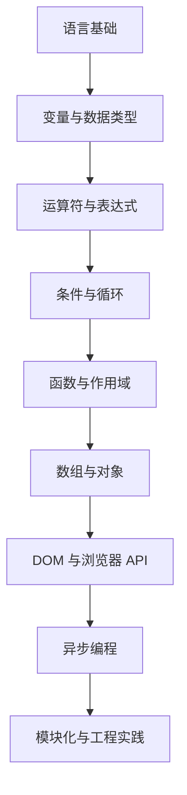

# JavaScript 学习知识库

> 从基础语法开始，通过小步练习、代码阅读和项目实践，逐步建立对 JavaScript 语言与 Web 开发的系统认识。

## 仓库定位

本仓库用于整理 JavaScript 学习资料与练习目录。当前内容以基础学习目录和思维导图资料为主；具体章节和示例以仓库内实际文件为准。

## 内容导航

| 目录 | 用途 |
|---|---|
| [ABasic/](ABasic/) | 基础学习与练习目录 |
| [MindManager/](MindManager/) | 思维导图及相关学习资料 |
| [.vscode/](.vscode/) | 编辑器工作区配置（如有） |

## 建议学习路径

上图是建议路线，不代表仓库中的所有章节都已完成。学习时请以实际代码和资料为准。

## 如何使用

1. 从 `ABasic/` 中选择一个练习目录。
2. 阅读资料后，尝试独立写出示例，并记录输入、输出和边界情况。
3. 对浏览器相关示例，可使用现代浏览器开发者工具观察运行结果。
4. 完成练习后，补充自己的解释、常见错误与小结。

## 练习建议

- 每个示例尽量聚焦一个知识点。
- 为函数和算法准备正常输入、边界输入和异常输入。
- 优先使用可运行的最小示例，避免只复制代码而不理解结果。
- 新增内容时，请同步更新目录索引，避免出现“文件存在但无法从 README 找到”的情况。

## 相关入口

- [个人主页](https://likui.info/)
- [技术站点导航](https://likui.info/#spaces)
- [GitHub 全部仓库](https://github.com/ilikui?tab=repositories)

---

**维护原则：** 保留原有学习资料，逐步补齐目录、可运行示例、练习题和验证说明。